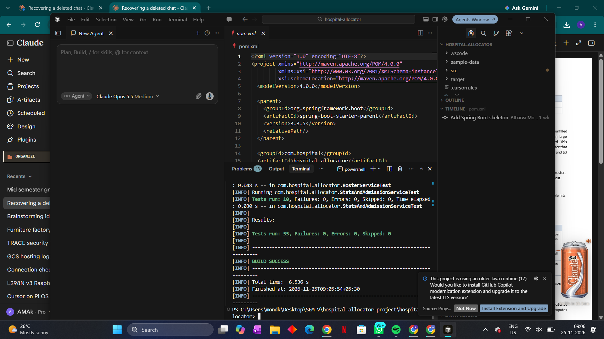
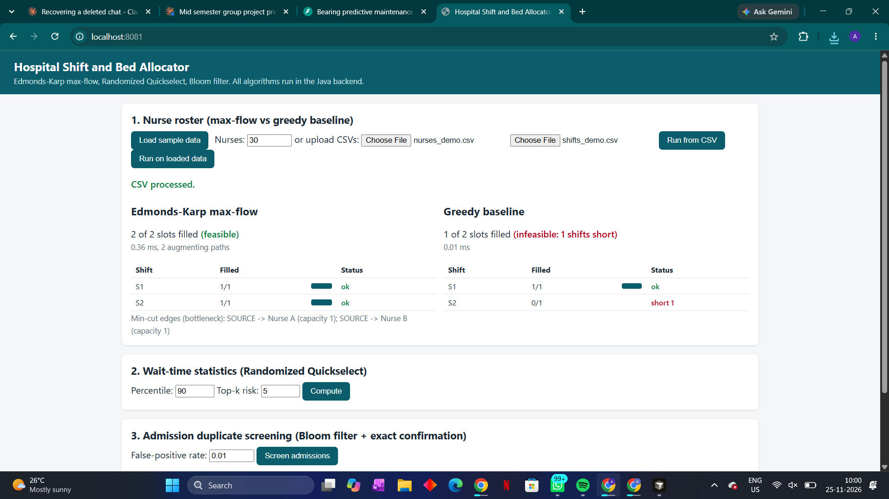
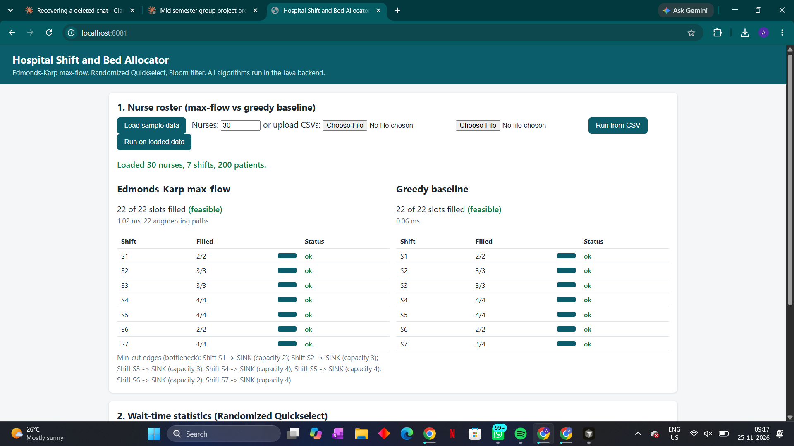
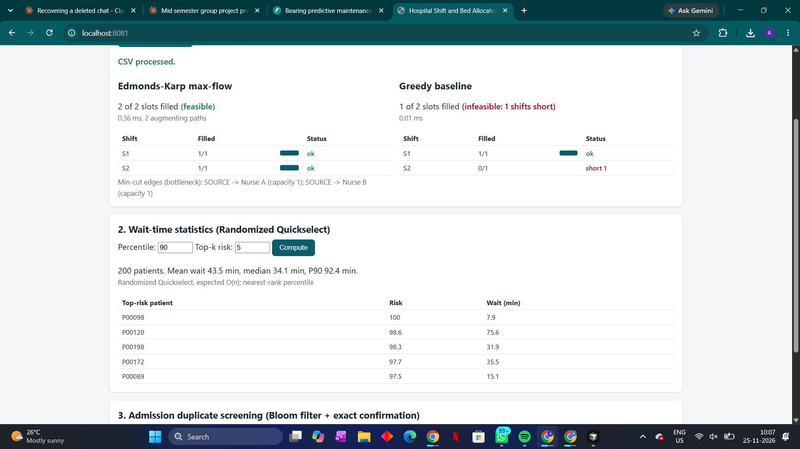
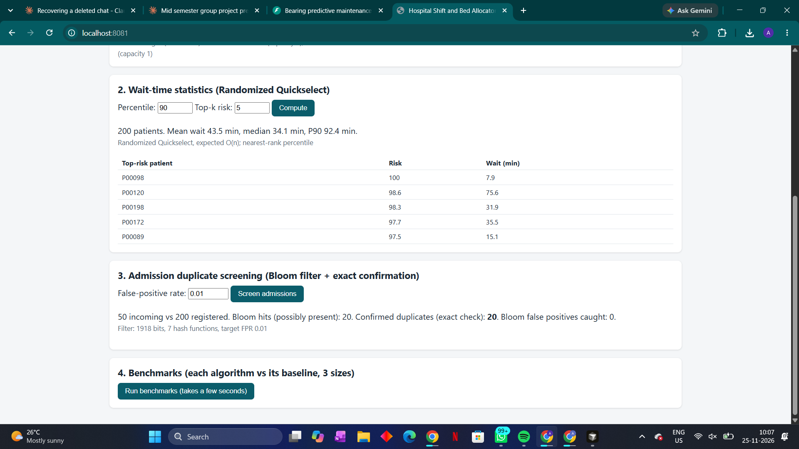
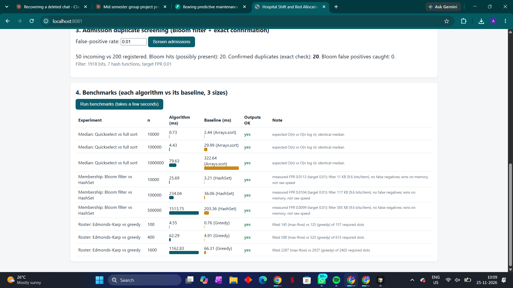
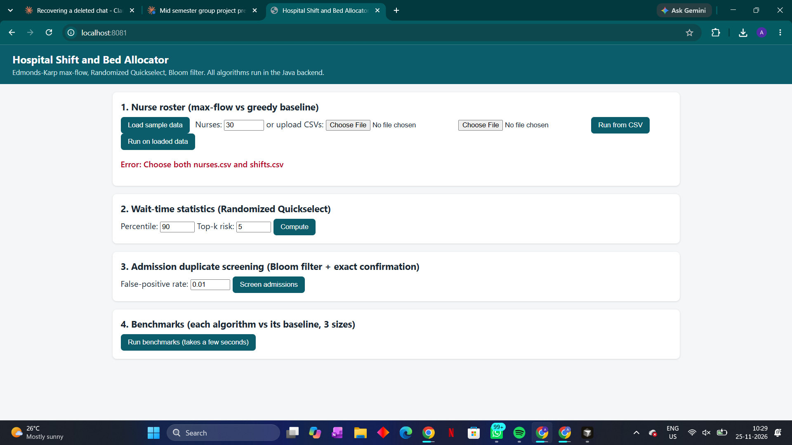

# Hospital Shift and Bed Allocator

Advanced Algorithm, CIA 3 (Semester V). A Java/Spring Boot application that staffs hospital shifts and screens admissions using three self-implemented algorithms.

| Algorithm | Unit / CO | Used for | Baseline |
|---|---|---|---|
| Edmonds-Karp max-flow / min-cut | Unit 5 / CO4 | Nurse-to-shift roster, bottleneck explanation | Greedy assignment |
| Randomized Quickselect | Unit 6 / CO5 | Median, percentile wait times, top-k risk patients | Full sort (`Arrays.sort`) |
| Bloom filter | Unit 6 / CO5 | Duplicate patient-ID prescreen at admission | `HashSet` (also the exact confirmation step) |

All three live in `src/main/java/com/hospital/allocator/algo/` and are written from scratch. Spring only provides the REST infrastructure. `Arrays.sort`, `HashSet` and the greedy assigner appear only as baselines.

## Prerequisites
- JDK 17 or newer
- Maven 3.8+ (internet access for the first dependency download)

## Build, test, run
```bash
mvn test                  # runs all JUnit tests
mvn spring-boot:run       # starts on http://localhost:8080
```
Open `http://localhost:8080` for the UI: load sample data, run the roster, statistics and admission checks, and run the benchmarks.

If port 8080 is already in use, run on another port, for example:
```bash
mvn spring-boot:run "-Dspring-boot.run.arguments=--server.port=8081"
```

## Sample data
- `sample-data/nurses.csv`, `sample-data/shifts.csv`: a tiny hand-made roster. Upload both through the UI ("Run from CSV").
- `sample-data/nurses_demo.csv`, `sample-data/shifts_demo.csv`: a two-nurse, two-shift case where greedy fills 1 of 2 slots and max-flow fills 2 of 2. Upload both through the UI to see the difference.
- `GET /api/sample?nurses=30&seed=42` generates seeded synthetic data (nurses, shifts, patients, admission IDs). Same seed gives the same data.

CSV formats:
```
nurses.csv : id,skill,maxShifts,availableShifts      (availableShifts separated by ';')
shifts.csv : id,requiredSkill,headcount              (requiredSkill: ANY, ICU, ER, GENERAL, ...)
```

## API examples
```bash
# Roster (algorithm = maxflow | greedy); /api/roster/compare returns both
curl -X POST localhost:8080/api/roster/compare -H "Content-Type: application/json" -d '{
  "nurses":[{"id":"A","skill":"GENERAL","maxShifts":1,"availableShifts":["S1","S2"]},
            {"id":"B","skill":"GENERAL","maxShifts":1,"availableShifts":["S1"]}],
  "shifts":[{"id":"S1","requiredSkill":"ANY","headcount":1},
            {"id":"S2","requiredSkill":"ANY","headcount":1}]}'

# Wait-time statistics
curl -X POST localhost:8080/api/stats -H "Content-Type: application/json" -d '{
  "patients":[{"id":"P1","waitMinutes":15,"riskScore":40},{"id":"P2","waitMinutes":50,"riskScore":90}],
  "percentile":90,"topK":1,"seed":1}'

# Admission duplicate screening
curl -X POST localhost:8080/api/admissions/check -H "Content-Type: application/json" -d '{
  "existingIds":["P1","P2"],"incomingIds":["P2","P9"],"falsePositiveRate":0.01}'

# Benchmarks
curl localhost:8080/api/benchmark
```

## Inputs, outputs, constraints, assumptions
- **Roster input:** nurses (id, skill, max shifts, available shifts) and shifts (id, required skill, headcount). **Output:** assignments, per-shift fill and shortfall, per-nurse utilization, bottleneck shifts, min-cut edges.
- **Model:** SOURCE to nurse (capacity = max shifts), nurse to shift (capacity 1, only if available and skill matches), shift to SINK (capacity = headcount). Max flow is the most slots that can be filled, and the min cut shows what limits it.
- **Statistics:** nearest-rank percentile; median is the 50th percentile (lower median for even n). Top-k breaks ties by input order.
- **Admissions:** a Bloom hit means "possibly present" and is always confirmed against an exact set. Only confirmed hits are reported as duplicates.
- **Failure cases handled (HTTP 400 with a message):** empty datasets, duplicate IDs, negative capacities, non-positive headcount, unknown shift references, malformed CSV (reports the line), invalid percentile / top-k / false-positive rate, malformed JSON. An infeasible roster is reported honestly with its shortfall and cut, never silently "fixed".
- **Assumption:** one nurse works a given shift at most once; all shifts are independent (no rest-time rules).

## Complexity
| Algorithm | Time | Space |
|---|---|---|
| Edmonds-Karp | O(V E^2) worst case; about O(F E) here since each augmentation pushes 1 unit (F = flow value) | O(V + E) |
| Randomized Quickselect | expected O(n), worst case O(n^2) with vanishing probability | O(1) extra |
| Bloom filter | O(k) per add / query, k = hash count | O(m) bits, m = -n ln p / (ln 2)^2 |

## Benchmarks
`GET /api/benchmark` (or the UI button) runs fixed-seed experiments at three sizes each and reports algorithm vs baseline time and whether outputs agree. Record your own machine's numbers in the report. Expect: Quickselect faster than a full sort and growing roughly linearly; the Bloom filter using about 10 bits per item (far less memory than a HashSet) but not being faster in raw time; max-flow slower than greedy per run but filling more slots when supply is tight.

## Tests
`mvn test` runs 50+ JUnit 5 tests: at least five per core algorithm (including boundary cases: single element, empty filter, zero-capacity edge, empty registry), a brute-force optimality check for the roster on 200 small random instances, CSV and validation tests, and API integration tests.

## Project layout
```
src/main/java/com/hospital/allocator/
  algo/      EdmondsKarp, RandomizedQuickselect, BloomFilter   (assessed, self-written)
  service/   RosterService, StatsService, AdmissionService, BenchmarkService
  web/       ApiController, ApiExceptionHandler
  model/     request / response records
  util/      CsvParser, DataGenerator
src/main/resources/static/index.html   frontend (plain JS, calls the Java API)
src/test/java/...                      JUnit tests
sample-data/                           small CSV inputs
```

## Screenshots
Taken from the running application (port 8081 on the demo machine).

**Tests: 55 passing**



**Roster: max-flow fills 2 of 2 slots, greedy fills 1 of 2 (demo CSVs)**



**Roster on the generated sample data (min-cut shown)**



**Wait-time statistics (randomized Quickselect)**



**Admission screening (Bloom filter + exact confirmation)**



**Benchmarks: each algorithm against its baseline**



**Error handling: invalid input gives a clear message**



## Team
Atharva Mondkar and Atharva Phale. Add each person's contribution to the report and keep commits attributed to each author.
